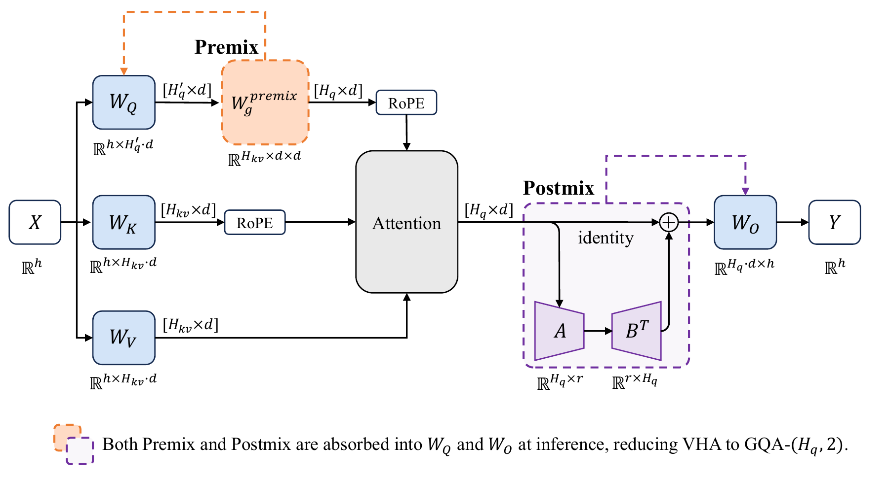

# Virtual Head Attention (VHA)

Xibo Ding, Guoxia Wang, Jinle Zeng, Jiabin Yang, Sirui Tao, Chao Yang, Dianhai Yu

*NeurIPS 2026 (accepted) · Paper forthcoming*

Reducing the number of KV heads shrinks the KV cache of grouped-query attention (GQA), but can reduce model quality. Virtual Head Attention (VHA) addresses this trade-off with two training-time operations: **Q Premix** creates virtual query heads from fewer physical heads, and **Linear Postmix** mixes their outputs. Both are linear and can be folded into the query and output projections after training, yielding standard GQA-2 without a VHA-specific inference kernel.



## Paper results

With two KV heads, VHA improves the eight-task average over GQA at each of four matched pretraining scales (0.6B to 8B-A1B) while lowering calculated training and prefill FLOPs. Its KV cache is one-quarter of GQA-8's in dense models and half of GQA-4's in the MoE model. Separate experiments examine a 30B-A3B MoE and contexts up to 128K.

## Quick start

This repository provides the training-time VHA implementation in PaddleFleet and a single-GPU GPT example. On Linux x86-64 with an NVIDIA GPU and a CUDA 13-compatible driver, run it with [uv](https://docs.astral.sh/uv/getting-started/installation/):

```bash
uv sync --locked --python 3.12
CUDA_VISIBLE_DEVICES=0 uv run --locked python examples/vha_tiny_gpt.py
```

The [example](examples/vha_tiny_gpt.py) trains a two-layer GPT in FP32 on synthetic tokens for two steps, checking finite losses, VHA gradients, and parameter updates.

## Implementation

Set `use_vha_attention=True` in [`GPTConfig`](src/paddlefleet/models/gpt/gpt_config.py) to enable VHA for GPT layers. The implementation spans [configuration](src/paddlefleet/transformer/transformer_config.py), [GPT layer selection](src/paddlefleet/models/gpt/gpt_layer_specs.py), and the [attention layer](src/paddlefleet/transformer/attention.py). The current VHA attention path requires tensor-parallel degree 1.

## Citation

If you use VHA, please cite:

```bibtex
@inproceedings{ding2026virtualheadattention,
  title={{Virtual Head Attention}},
  author={Ding, Xibo and Wang, Guoxia and Zeng, Jinle and Yang, Jiabin and Tao, Sirui and Yang, Chao and Yu, Dianhai},
  booktitle={Advances in Neural Information Processing Systems},
  year={2026},
  note={To appear}
}
```

## License

This code builds on PaddleFleet and is licensed under [Apache 2.0](LICENSE).
